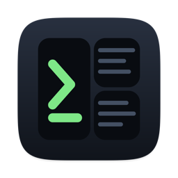
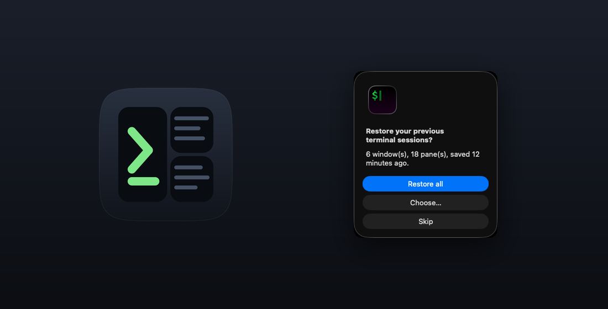
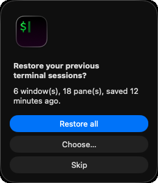
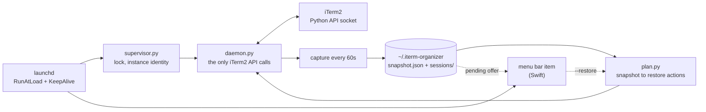

<div align="center">



# iTerm Organizer

**Your iTerm2 windows, tabs and split panes survive a crash or a reboot.**

Snapshots your terminal layout every 60 seconds. Offers to rebuild all of it the next time iTerm2 starts.




</div>

---

## The problem

Power drops mid-afternoon. iTerm2 reopens empty. Six windows, eighteen panes, four repos on four different branches, and no record of what any of them was doing.

iTerm Organizer fixes that. It runs quietly in the background, and when iTerm2 comes back it asks you once:

<div align="center">

</div>

Say yes and your terminal comes back the way you left it.

## What it restores

- **Layout.** Window geometry, tabs, and the full nested split-pane tree
- **Context.** Each pane's working directory and iTerm2 profile
- **Memory.** Pane titles plus a one-line banner showing directory, git branch, and the command that was running
- **Work in progress.** Long-running dev processes, under an allowlist you control
- **Claude Code sessions.** Resumed with `claude --continue`

## The menu bar item

The app also installs a small menu bar item. It shows when the last snapshot
was taken, whether the agent is running, and - if a restore was offered and
never answered - keeps that offer available:

- **Restore N window(s) from HH:MM** - take the offer you missed
- **Restore last session** - rebuild the newest snapshot on demand
- **Snapshot now**, **Show details**, **Open log**

It is built only when a Swift toolchain is present at build time; without one
the rest of the app works unchanged.

## Install

**As an app** (recommended):

```bash
git clone https://github.com/josephhamawi/iterm-organizer.git
cd iterm-organizer
./build-app.sh                 # builds ~/Development/iTermOrganizer
```

Then double-click `Install.command` in that folder. The bundle carries its own code and dependencies, and uses any Python 3.11+ already on the machine.

**From the checkout** (development):

```bash
./install.sh
```

That is the whole install. It creates a private virtualenv, writes a launchd agent, and starts it immediately. iTerm2 does not need restarting, and iTerm2's own Python runtime is never involved.

Uninstall with `./uninstall.sh`. It stops and removes the agent and the CLI. Your snapshots and config stay put.

| Path | Purpose |
| --- | --- |
| `~/.iterm-organizer/config.toml` | your settings (never overwritten if it exists) |
| `~/.iterm-organizer/` | snapshots, state, logs |
| `~/Library/LaunchAgents/com.rami.iterm-organizer.plist` | the agent |
| `~/Library/LaunchAgents/com.rami.iterm-organizer.menu.plist` | the menu bar item |
| `~/.local/bin/iterm-organizer` | CLI |

## Everyday use

```bash
iterm-organizer --dry-run       # show what would be restored, change nothing
iterm-organizer --list          # list retained snapshots
iterm-organizer --snapshot-now  # capture immediately
iterm-organizer --restore       # restore now, from the latest snapshot
iterm-organizer --restore ~/.iterm-organizer/sessions/20260827-141500.json
tail -f ~/.iterm-organizer/organizer.log
```

Running the CLI from a shell inside iTerm2 works without any permission prompt, because iTerm2 is already trusted to send Apple Events to itself.

The last 20 distinct snapshots are kept, so you can go back to an hour ago rather than only to the last save.

## Safety: how commands are replayed

Replaying a command read out of the process table is code execution at login, and it is treated as such. Every recovered command falls into exactly one of three tiers.

| Tier | Behaviour | Example |
| --- | --- | --- |
| `autorun` | executed on restore | `npm run dev`, `flutter run`, `claude` |
| `never` | shown in the banner, never typed or run | `ssh`, `sudo`, `git rebase`, `vim` |
| everything else | **typed into the pane without pressing Enter** | `./deploy.sh --prod` |

The third tier is the important one. An unrecognized command is put in front of you, ready to run, waiting for you to press Enter. Nothing you did not explicitly allowlist ever executes by itself.

On top of that:

- Only an exact `autorun` match is ever executed.
- Any recovered command containing a newline or a control character is dropped entirely, so a crafted process name cannot smuggle in a second command.
- A pane's directory must still exist before any command is sent. If the directory is gone, the pane opens in `$HOME`, the banner says so, and the command is downgraded to banner-only rather than run somewhere unintended.
- Paths are quoted with `shlex.quote`. The banner is printed via `printf` with a quoted argument, so it cannot execute.
- Restores are capped at `max_restore_panes` (40) and never reuse the window you are currently working in.

Flags are replayed faithfully. If a pane was running `claude --dangerously-skip-permissions`, restore brings it back with that flag.

## Configuration

Edit `~/.iterm-organizer/config.toml`. Patterns are regexes and must use TOML *literal* strings (single quotes), or `\b` is parsed as a backspace:

```toml
[jobs]
autorun = ['^make watch$']
never   = ['^terraform apply']
```

`never` is checked before `autorun`, so `sudo npm run dev` is never executed.

Set `restore_prompt = "auto"` to skip the dialog and restore straight away, or `"off"` to disable restore entirely.

Full reference: [`docs/app/CONFIGURATION.md`](docs/app/CONFIGURATION.md).

## How it stays running

launchd starts the agent at login with `KeepAlive` / `SuccessfulExit=false`:

- iTerm2 quits or crashes, so the websocket closes and the process exits non-zero. launchd restarts it and it waits for iTerm2 to come back.
- Another instance already holds the lock, so the process exits **zero** and launchd leaves it down rather than respawning in a loop.

An advisory `flock` on `~/.iterm-organizer/daemon.lock` guarantees one daemon at a time. The kernel drops it when the process dies, so a crash cannot leave a stale lock. That matters, since crashing is what this tool exists for.

The menu bar item runs as a second launchd job so it stays up while the daemon comes and goes, and `ProcessType` is `Adaptive` rather than `Background`: the agent has user-facing work to do at login, when the machine is busiest, and background priority throttled it into taking minutes to get a prompt up.

The plist sets `AssociatedBundleIdentifiers = com.googlecode.iterm2`. Without it the agent blocks forever: connecting needs an auth cookie that the iterm2 library requests over AppleScript, and for an unattributed launchd job macOS raises a TCC Automation prompt that never surfaces. Attributing the agent to iTerm2's bundle lets the request through.

## When it prompts

Restore is offered **once per iTerm2 instance**, keyed on iTerm2's pid (or, if `ps` cannot be read, on the mtime of iTerm2's API socket):

- Installing while you are working adopts the running instance and stays quiet.
- A daemon restart against the same iTerm2 never re-prompts.
- A genuinely new iTerm2, after a reboot, a crash, or a manual relaunch, prompts once.

Window counts are deliberately not used as a freshness signal. After a reboot iTerm2 often reopens windows of its own, and requiring a single empty window would suppress the prompt in exactly the case that matters.

The decision is made **after** connecting, never before. At login launchd normally starts the agent before iTerm2 exists, so a pid read up front is `None`, and deciding then would disable restore for the whole session. Identifying the instance also retries, because at boot the load average can be high enough that a single `ps` times out.

The prompt is skipped when the snapshot is older than `stale_days` (7) or is trivial (a single pane in `$HOME` with nothing running).

## Design



`daemon.py` holds every iTerm2 API call. Everything with logic in it is pure and tested without iTerm2 running.

| Module | Responsibility |
| --- | --- |
| `model.py` | snapshot types, JSON round-trip, git branch, atomic storage |
| `jobs.py` | process-table parsing, tree walking, tier classification |
| `config.py` | config loading and validation |
| `plan.py` | snapshot to an ordered list of restore actions |
| `daemon.py` | iTerm2 glue only |
| `lock.py` | single-instance advisory lock |
| `supervisor.py` | process lifecycle, iTerm2 pid tracking, restore gating |
| `agent.py` | launchd job definitions, install/uninstall, status |
| `packaging/menubar/main.swift` | the menu bar item (no logic of its own; calls the CLI) |

Snapshots are written to a temp file and `os.replace`d, with the previous version kept alongside, so a crash mid-write cannot leave you without a readable snapshot. An empty snapshot is never written over a good one.

Full design document: [`docs/superpowers/specs/2026-08-27-iterm-organizer-design.md`](docs/superpowers/specs/2026-08-27-iterm-organizer-design.md).

## Troubleshooting

```bash
launchctl print gui/$UID/com.rami.iterm-organizer   # is it running?
tail -f ~/.iterm-organizer/organizer.log            # what is it doing?
cat ~/.iterm-organizer/launchd.err.log              # did it fail to start?
```

If the log stops after `iterm2 module loaded` and never reaches `starting`, the agent is blocked on the AppleScript cookie. Check that `AssociatedBundleIdentifiers` is still present in the plist.

If a restore prompt never appears, check whether two copies of iTerm2 are installed:

```bash
ps -axo pid=,comm= | grep '/MacOS/iTerm2$'
```

The cookie request resolves iTerm2 by bundle id, so with two copies it can connect to - and show its alert in - the copy you are not using. The agent aims at the running copy via `IT2_APP_PATH` and reports the clash in `--status`, but one copy is still the tidier answer.

More: [`docs/app/TROUBLESHOOTING.md`](docs/app/TROUBLESHOOTING.md).

## Tests

```bash
python3 -m venv .venv && .venv/bin/pip install pytest iterm2
.venv/bin/python -m pytest
```

204 tests, no iTerm2 instance required.

## Requirements

- macOS 11 or later
- iTerm2 with the Python API enabled (Preferences → General → Magic → Enable Python API)
- Python 3.11 or later

## Contributing

Issues and pull requests are welcome. The logic modules are pure and unit-tested, so most changes can be verified without iTerm2 running at all. See [CONTRIBUTING.md](CONTRIBUTING.md) for the layout, conventions, and the one rule that keeps this maintainable.

## License

MIT. See [LICENSE](LICENSE).
